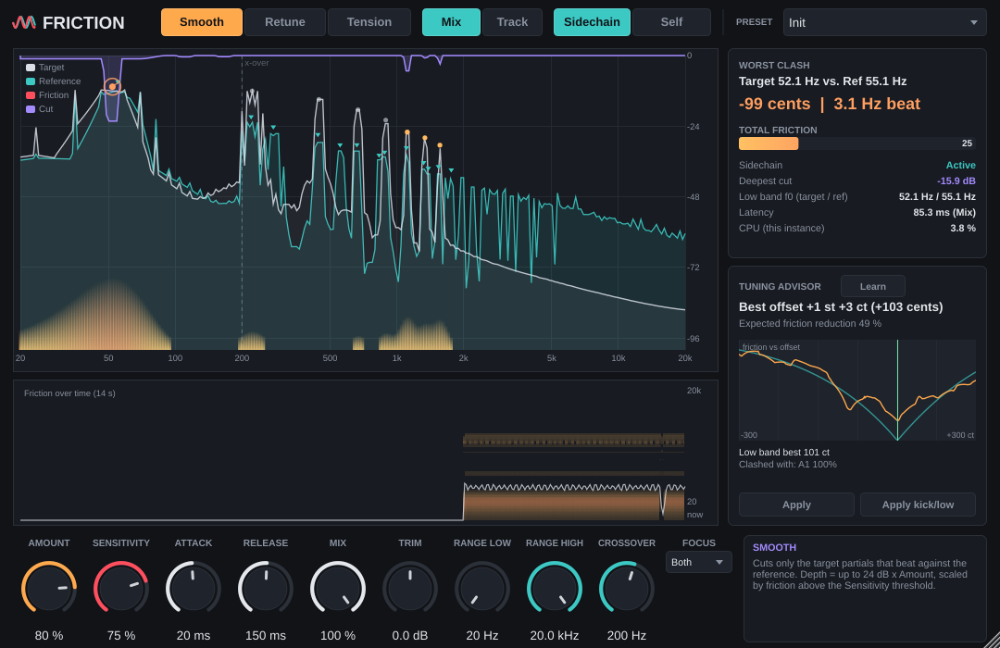

# Friction

Friction is a sidechain plug-in (VST3 and Standalone, JUCE) that finds and controls the
**psychoacoustic roughness** (beating, sensory dissonance) between two tracks. Put it on the
**target** track and feed it a **reference** track through its sidechain input. It shows which target
partials beat against the reference, how fast and how badly. It can then:

* **Smooth**: cut only the clashing target partials, with narrow dips that follow them;
* **Retune**: move the clashing partials, or the whole target, to a low-roughness relation with the
  reference;
* **Tension**: deliberately add roughness, for wobble or grit that follows the reference's harmony.

A **Tuning Advisor** listens to a passage and reports the best global tuning offset for the target,
including a kick-versus-bass report (kick fundamental, the bass notes it clashes with, and the
best-compromise kick tuning).

The reference is only analysed. It is never altered or output.



---

## Status: what was built and tested

Read this before using it.

| | Built | Tested |
|---|---|---|
| DSP core + offline harness, **Linux** (GCC 13.3, this repo's container) | yes | **68/68 checks pass** ([TEST_REPORT.md](TEST_REPORT.md)), including **0 heap allocations** in 10,990 `process()` calls |
| JUCE plug-in, **Linux** VST3 + Standalone | yes | 10/10 plug-in checks pass (incl. 0 allocations in 2,250 `processBlock` calls); **pluginval 1.0.4 strictness 10: pass**; **Steinberg VST3 validator (SDK 3.8.1, extensive): 537/537** |
| JUCE plug-in, **Windows x64 (MSVC)** VST3 + Standalone | on **GitHub Actions** (`windows-latest`, Visual Studio 2022), not in this container | the full harness, the plug-in tests and pluginval run in the same CI job (see below) |
| Inside real DAWs (Live, FL Studio, Reaper, Cubase, Studio One, Bitwig) | – | **not tested.** The routing steps below follow each DAW's documentation. |
| Listening tests / real recordings | – | **not done.** All measurements use synthetic signals (sines, saws, kicks, piano-like and pad-like tones). |
| Standalone app | yes | built and launched only through the tests (editor snapshots); never run interactively here (no display) |

**Windows binaries.** This development container is Linux, and its network policy blocks the
Microsoft SDK/CRT downloads, so MSVC cannot run here. The CMake project targets MSVC directly.
`.github/workflows/build.yml` builds it with MSVC on every push, runs the test harness, the
plug-in tests and pluginval, and uploads:

* `Friction-Windows-x64`: `Friction.vst3` (bundle folder) and `Friction.exe` (standalone)
* `Friction-Windows-test-report`: `TEST_REPORT_windows.md`, renders and pluginval logs

Download them from the run's page: <https://github.com/TimTham123/bassfrictionplugin/actions>.
The Windows build uses the static MSVC runtime, so no VC++ redistributable is needed.

---

## Installing

**Windows**
* VST3: copy the whole `Friction.vst3` folder to `C:\Program Files\Common Files\VST3\` and rescan
  plug-ins in your DAW.
* Standalone: run `Friction.exe`. JUCE's standalone wrapper feeds the plug-in's four inputs from the
  audio interface in order: inputs 1–2 are the target, 3–4 the reference. Enable four input
  channels in *Options → Audio/MIDI Settings*. The standalone is mainly useful for looking at the
  UI; inside a DAW is the intended use. **[not tested]**

**Linux**: copy `Friction.vst3` to `~/.vst3/`.

---

## Sidechain routing

Friction has one stereo main input/output (the target) and one stereo sidechain input (the
reference). Mono is accepted on both. The side panel shows the sidechain status:

* **Active**: the reference is arriving.
* **Sidechain silent**: the bus is connected but carries nothing. Friction does **no processing**
  (output = dry, latency-compensated).
* **No sidechain**: the host has not connected the bus. Friction falls back to **Self** mode and
  works on the target's own internal roughness (useful on detuned stacks and doubled takes). Self
  can also be chosen by hand.

**DAW steps** (from each DAW's documentation; menu names change between versions; **not tested by
me**):

* **Ableton Live (10.1 or later).** Put Friction on the target track. In the device's title bar, open
  the sidechain section (in Live 12 it is behind the small drop-down arrow next to the device
  on/off button) and switch **Sidechain** on. Then choose the reference track in **Audio From**.
* **FL Studio.** Put Friction in the target's Mixer insert. Select the *reference* insert,
  right-click the send arrow of the *target* insert and choose **Sidechain to this track**. Then
  open Friction's wrapper settings (gear icon) → **Processing** tab. Under the input connections,
  assign the sidechain (aux) input to the reference insert.
* **Reaper.** On the target track, open **Route** and set *Track channels* to **4**. On the
  reference track, add a send to the target track with audio **1/2 → 3/4**. In Friction's pin
  connector (the "2 in 2 out" button in the FX window), check that the sidechain inputs read
  channels 3/4. If the plug-in switches to an odd layout, use the pin connector's **IO** button →
  *Request VST3 bus channel count* → **Stereo**.
* **Cubase / Nuendo.** Insert Friction on the target track and open its window. Activate the
  plug-in's side-chain input with the side-chain button in the window header. In **Set up
  Side-Chain Routing** (older versions: *Side-Chain Inputs*), choose **Add Side-Chain Source** and
  select the reference track.
* **Studio One.** In Friction's plug-in window header, next to the preset menu, enable
  **Sidechain** and click its arrow to pick the reference. Alternatively, on the reference track
  choose **Sends → Sidechains → Friction**.
* **Bitwig Studio.** Click the sidechain icon at the top of the Friction device and choose the
  reference track (pre or post fader) in the selector. Keep the small sidechain level fader next to
  it at 0 dB.

---

## Quick start

1. Route the reference into the sidechain (above). The status should read **Active**.
2. Play both tracks and watch the map. **Clash markers** (dots coloured amber → red by friction)
   sit on the target partials that beat against the reference. The **Worst clash** readout shows,
   for example, `Target 52.1 Hz vs. Ref 55.1 Hz | -99 cents | 3.1 Hz beat`.
3. Choose a mode:
   * **Smooth** (default): raise **Amount** until the beating calms down. **Sensitivity** sets how
     rough a pair must be before anything happens. The purple curve shows the cuts.
   * **Retune**: *Per-partial* moves individual clashing partials (green labels show the shift in
     cents). *Whole Auto* finds one global micro-offset. *Whole Fixed* applies an offset you set,
     or the Advisor's.
   * **Tension**: *Synth* adds detuned copies of the reference's strongest partials. **Beat Rate**
     goes from slow wobble to fast grit. *Push* moves target partials toward the roughest spacing.
4. For a kick or bass part that clashes all song long, use the **Tuning Advisor**. Press **Learn**,
   play the section (10 s or more), then press **Stop**. It reports the best offset in cents
   (semitones + cents when ≥ 100 cents), the expected friction reduction and the
   friction-versus-offset curve. **Apply** switches to Retune / Whole Fixed with that offset.
   **Apply kick/low** does the same with the low-band (kick/bass) curve.
5. Use **Delta** to hear only what Friction removes (Smooth) or adds (Tension).

Right-click the map to switch between friction against the reference and the target-internal
(Self) view. Hover over a partial to read its frequency, level, friction, cut and shift.

### Factory presets
Init · Kick <> Bass · 808 <> Bass · Bass Retune (Whole Auto) · Kick Tuning (use Learn + Apply) ·
Vocal <> Pad · Double Vocal Smoother · Piano <> Synth · Guitar <> Keys · Piano Retune
(Per-partial) · Detuned Stack Cleaner (Self) · Tension Pad (Slow Wobble) · Tension Grit ·
Tension Push Lead · Live Smooth (Track)

---

## Controls

All parameters are automatable and are saved with the session.

| Control | Range (default) | What it does |
|---|---|---|
| Mode | Smooth / Retune / Tension (Smooth) | Processing mode |
| Latency | Mix / Track (Mix) | **Mix**: full quality, latency = FFT size (see below). **Track**: zero latency, Smooth only |
| Reference | Sidechain / Self (Sidechain) | What the target is compared with |
| Amount | 0–100 % (50) | Depth of cuts (up to 24 dB), size of shifts, level of tension voices |
| Sensitivity | 0–100 % (65) | Friction threshold. Higher values treat milder roughness |
| Attack / Release | 1–500 ms (20) / 10–2000 ms (150) | How fast cuts and shifts follow friction |
| Mix | 0–100 % (100) | Wet/dry, latency-compensated |
| Output Trim | ±24 dB (0) | Output gain |
| Range Low / High | 20 Hz–20 kHz | Only partials inside the range are processed (all are analysed) |
| Focus | Low / High / Both (Both) | Process only partials below, or above, the crossover |
| Crossover | 80–400 Hz (200) | Boundary between the low-band tracker (YIN) and the STFT analysis |
| Delta | off/on | Output only the difference (wet − dry) |
| Max Cents | 1–100 cents (50) | Largest Retune/Push shift |
| Retune Style | Per-partial / Whole Auto / Whole Fixed | See Quick start |
| Whole Offset | ±1200 cents (0) | Offset for Whole Fixed |
| Beat Rate | 0–100 % (40) | Tension: slow wobble (~1 Hz at 440 Hz) up to the roughest spacing |
| Tension Style | Synth / Push | See Quick start |

## Latency

| Mode | Latency reported to the host |
|---|---|
| Mix at 44.1 / 48 kHz | 4096 samples (92.9 / 85.3 ms) |
| Mix at 88.2 / 96 kHz | 8192 samples |
| Mix at 176.4 / 192 kHz | 16384 samples |
| Track (any rate) | 0 |

Smooth, Retune and Tension share the Mix latency, so switching modes never changes the latency.
Switching Mix ↔ Track does change it. Friction mutes over 10 ms and reports the new value to the
host. Bypass is latency-compensated.

**Track mode trade-offs:** decisions lag the audio, because the analysis cannot look ahead. Dips
arrive a few tens of milliseconds late on new notes. The high band uses a shorter analysis window,
so frequency precision is lower. At most 24 + 8 dips can be active at once, and they are
minimum-phase bell filters. There is no Retune or Tension.

## CPU

Measured by the harness on the container's 2.1 GHz Xeon, one thread, 48 kHz, stereo target and
stereo sidechain, block 256:

| Mode | % of one core |
|---|---|
| Mix / Smooth | 4.5 |
| Mix / Retune per-partial | 7.8 |
| Mix / Retune whole auto | 6.3 |
| Mix / Tension synth | 4.4 |
| Track / Smooth | 2.4 |

The Windows CI report contains the same measurements on the GitHub runner.

---

## Building from source

Requirements: CMake ≥ 3.22 and a C++17 compiler. JUCE 8.0.15 is fetched automatically (CMake
`FetchContent`, pinned tag). To use a local JUCE checkout of the same tag, pass
`-DFETCHCONTENT_SOURCE_DIR_JUCE=<path>`.

**Windows (Visual Studio 2022, x64)**
```bat
cmake -S . -B build -A x64
cmake --build build --config Release --parallel
build\tests\Release\FrictionTests.exe --report TEST_REPORT.md
```
Output: `build\src\plugin\Friction_artefacts\Release\VST3\Friction.vst3` and
`build\src\plugin\Friction_artefacts\Release\Standalone\Friction.exe`.

**Linux**
```sh
sudo apt-get install ninja-build libasound2-dev libx11-dev libxrandr-dev libxinerama-dev \
  libxcursor-dev libxcomposite-dev libxext-dev libfreetype-dev libfontconfig1-dev libgl-dev
cmake -S . -B build -G Ninja -DCMAKE_BUILD_TYPE=Release
cmake --build build
./build/tests/FrictionTests --report TEST_REPORT.md
./build/src/plugin/FrictionPluginTests_artefacts/Release/FrictionPluginTests --append-report TEST_REPORT.md
```

Options: `-DFRICTION_BUILD_PLUGIN=OFF` builds only the DSP core and the harness, with no JUCE
download. `-DFRICTION_BUILD_TESTS=OFF` skips the harness.

### Test harness
`FrictionTests` runs every check and writes the markdown report and the WAV renders. Options:
`--out <dir>`, `--renders <dir>`, `--no-renders`, `--quick`, `--only "<group> <group>"`,
`--report <file>`, `--allow-perf-fail` (CPU checks are reported but do not fail; used on CI
runners, whose speed varies). `FrictionPluginTests` drives the real `AudioProcessor` and editor:
bus layouts, latency, bypass, state, presets, missing sidechain, automation stress, Advisor
Learn → Apply, and editor snapshots.

### Renders (`renders/`)
4-second excerpts (demos: 8–10 s), 16-bit mono, written by the harness. "mix" files are
target + reference, as you would hear them together.

| File | What it shows |
|---|---|
| `smooth_saws_{before,after}_mix.wav`, `smooth_saws_target_{before,after}.wav` | Two saws 8 cents apart. Smooth cuts the beating partials |
| `smooth_lowband_{before,after}_mix.wav` | 55 Hz vs 57.2 Hz bass beating, cut by the tracking bells |
| `smooth_drums_after.wav` | Drum hits over a clashing tone: no pre-echo |
| `retune_whole_saws_{before,after}_mix.wav`, `retune_partial_saws_after_mix.wav` | Saw pair 8 cents (1.02 Hz) apart. Retune (whole / per-partial) drives the beat rate to 0 |
| `retune_drums_{before,after_partial,after_whole_fixed40}.wav` | Transient check for both Retune styles |
| `retune_pulse_{before,after_partial}.wav` | Phasiness check: pulse-like tone with shifted partials |
| `tension_synth_ref440_mix.wav`, `tension_push_saws_after_mix.wav` | Tension Synth and Push |
| `advisor_kick_bass_mix.wav` | Kick (52 Hz) vs bass line used for the Advisor test |
| `demo1_piano_vs_pad_{before,after_smooth,after_retune_partial,after_retune_whole}.wav` | Demo: piano-like part 18 cents sharp against an in-tune pad |
| `demo2_kick_vs_bass_{before,after_smooth,after_advisor_retune}.wav` | Demo: kick vs bass, Smooth (Focus Low) and Advisor-guided kick retune (+96 cents) |
| `ui_*.png` | Editor snapshots in every mode and two sizes |

---

## Repository layout

```
CMakeLists.txt            top level (JUCE via FetchContent, pinned 8.0.15)
src/core/                 JUCE-independent DSP: roughness model, STFT/reassignment peaks, YIN low-band
                          tracker, onset detector, bells, partial shifter, whole-signal shifter, synth,
                          Advisor, engine
src/plugin/               JUCE AudioProcessor, parameters, presets, editor and UI components
tests/                    offline harness (FrictionTests) and plug-in tests (tests/plugin)
renders/                  WAV renders and UI snapshots from the last harness run
DESIGN.md                 research summary, models, signal flow, parameters, latency, decisions
TEST_REPORT.md            measured results of the last run
.github/workflows/        CI: Windows x64 MSVC and Linux builds, tests, pluginval, artefacts
```

## Known limitations

* The roughness model is a steady-state sine-pair model (Sethares/Vassilakis) summed over partial
  pairs. It was not validated by listening tests here (see DESIGN.md §1).
* Mix mode has ~85–93 ms latency. Track mode is Smooth-only and less precise.
* Per-partial Retune passed the artifact tests (transient smearing, phasiness, out-of-range
  partials), but only on synthetic material. On dense polyphonic material, Whole-signal Retune or
  Smooth are the safer choices.
* In Smooth and per-partial Retune, the 25 ms before each detected onset is passed through dry, to
  avoid pre-echo. On very dense rhythmic material this reduces the processed share of the signal.
* Whole-signal Retune shifts time by up to ±10 ms between splices; hits are kept on time by
  onset-aligned splices (measured worst displacement 0.04 ms).

## Licence

Friction's own source code carries no licence file yet; add one before distributing. JUCE is
used under its own licence: JUCE 8 is available under the AGPLv3 or a commercial JUCE licence.
Check the terms of JUCE and of the VST3 SDK it bundles before you distribute binaries.
